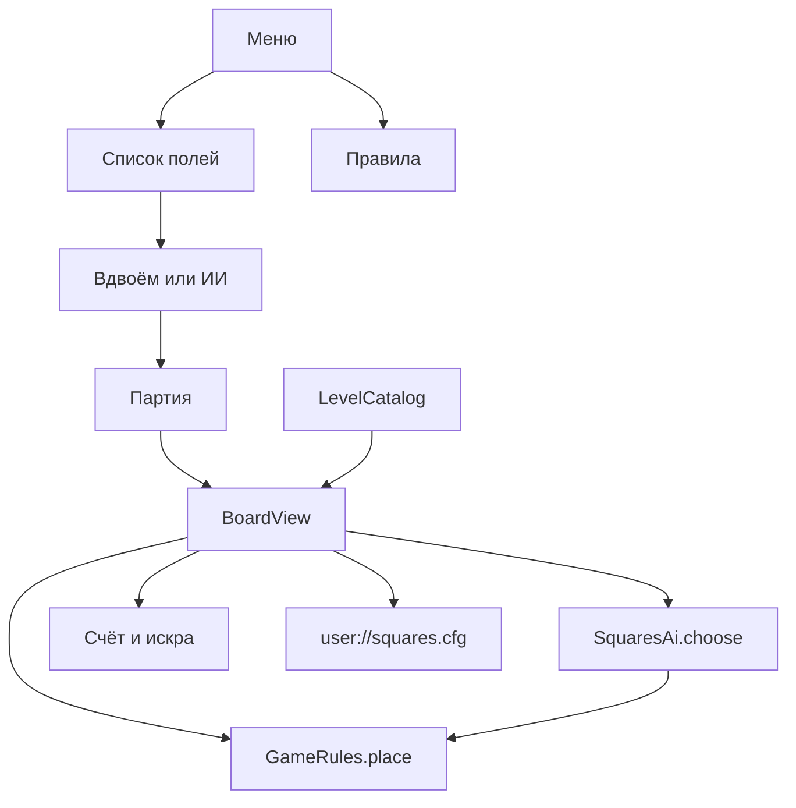
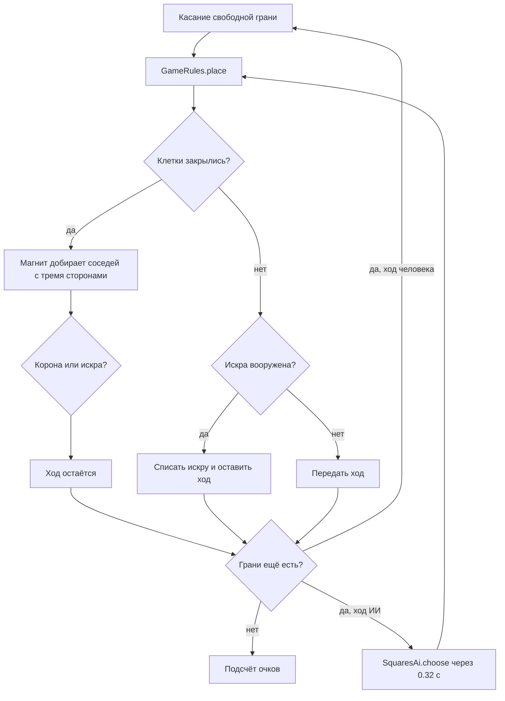

# Квадраты

Мобильная игра в «загончики» на Godot 4. Игроки по очереди ставят палочки по сторонам клеток. Кто закрывает клетку, забирает её и ходит снова. На поле бывают дыры, а в клетках лежат ресурсы: они дают очки и бустеры. Партию можно сыграть вдвоём на одном экране или против ИИ.

Проект рассчитан на телефон в портретной ориентации. Логический размер экрана — 720×1280, картинка растягивается под устройство. На компьютере игра открывается в узком окне того же формата.

## Правила

1. Ходят по очереди. За ход ставится одна палочка — сторона одной клетки. На телефоне это жест «палец на грань и отпускание».
2. Четвёртая палочка закрывает клетку. Её забирает тот, кто поставил эту палочку, даже если остальные три ставил соперник.
3. После захвата ход не переходит. Так игрок забирает целую цепочку, пока закрываются новые клетки.
4. Одна палочка может закрыть сразу две клетки, если она для них общая.
5. Дыра — пустое место внутри поля. Там нет клетки, и через неё палочки не ставятся.
6. Побеждает тот, у кого больше очков. Обычная клетка стоит 1. Ничья возможна.

Алые отмечают клетку крестиком, Бирюза — кружком. Кто начинает партию, решает жребий. Против ИИ человек всегда играет за Алых.

## Ресурсы

Ресурс получает тот, кто закрыл клетку.

| Ресурс | Знак | Эффект |
| --- | --- | --- |
| Самоцвет | ромб | Клетка стоит 2 очка |
| Корона | корона | Клетка стоит 3 очка и даёт искру |
| Искра | молния | Запасная палочка. Кнопка «Искра», затем грань: ход остаётся у вас, даже если клетка не закрылась |
| Магнит | подкова | Вместе с клеткой забирает соседние, у которых уже стоят три стороны. Недостающую палочку магнит ставит сам. Если среди забранных клеток тоже есть магнит, захват продолжается |

Искра тратится только на ход без захвата. Если вооружённая искра всё же закрыла клетку, запас не списывается: продолжение хода и так даёт правило захвата.

## Поля

Маски лежат в `scripts/levels.gd`. `#` — клетка, `.` — дыра. Строки одной длины. Ресурс задаётся ключом `"ряд,столбец"`.

| id | Название | Форма |
| --- | --- | --- |
| `gate` | Калитка | Квадрат 2×2 без ресурсов |
| `yard` | Двор | Квадрат 3×3, самоцвет в центре |
| `square` | Площадь | Квадрат 4×4, самоцветы по углам, искра и магнит |
| `pond` | Пруд | Кольцо вокруг большой дыры |
| `cross` | Крест | Рукава и корона в центре |
| `stairs` | Лестница | Ступени |
| `islands` | Острова | Две отдельные базы |
| `snake` | Змейка | Коридор с поворотами |
| `fort` | Крепость | Плотное поле 5×5 |

Рекорды против ИИ пишутся в `user://squares.cfg`, отдельно для спокойного и внимательного уровня.

## Архитектура

Игра почти целиком на GDScript. Сцена одна: весь интерфейс собирается кодом. Правила не знают про отрисовку, ИИ не меняет настоящую партию, а гоняет копию состояния.

```text
scenes/main.tscn          корень, скрипт main.gd
scripts/main.gd           экраны, тема, рекорды
scripts/board.gd          поле, ввод, ход, анимация
scripts/rules.gd          грани, захват, магнит, очки
scripts/levels.gd         маски полей и сборка доски
scripts/ai.gd             выбор хода
scripts/palette.gd        цвета и имена игроков
scripts/self_test.gd      проверка правил без окна
icon.svg
project.godot
```



### Экраны

`main.gd` держит четыре экрана и переключает их видимость: меню, правила, список полей, партия. Диалог режима и плашка результата лежат поверх своих экранов. Кнопка «Назад» на Android и Escape возвращают на предыдущий экран.

`BoardView` — это `Control`, который сам рисует поле в `_draw` и сам принимает касания. Отдельных спрайтов клеток нет.

Сигналы поля:

- `changed` — обновить счёт, ход и кнопку искры;
- `finished(scores, winner)` — показать итог и, в партии против ИИ, записать рекорд.

Пока открыт другой экран, поле вызывает `suspend()`: отложенный ход ИИ отменяется. Возврат в партию вызывает `resume()`.

### Состояние доски

Клетка — `Vector2i(столбец, ряд)`.

- `cells[Vector2i]` — `{owner, res}`. `owner` равен 0, 1 или 2.
- `h_edges[Vector2i]` — горизонтальная грань над клеткой `(столбец, ряд)`. Значение 0, пока грань свободна, иначе номер игрока.
- `v_edges[Vector2i]` — вертикальная грань слева от клетки `(столбец, ряд)`.
- `sparks` — массив `[0, искры Алых, искры Бирюзы]`.

У клетки четыре грани: верх `h(c, r)`, низ `h(c, r + 1)`, лево `v(c, r)`, право `v(c + 1, r)`. Грань между двумя клетками одна и та же. Дыра в словари не попадает, поэтому у неё нет граней.

`LevelCatalog.build()` по маске создаёт клетки и все законные грани со значением 0. `GameRules.place()` ставит грань и возвращает `{ok, claimed, edges, spark_gain}`. Функция меняет переданные словари на месте. ИИ перед вызовом делает `clone_state()`, поэтому пробный ход не трогает партию.

Фазы поля: ход человека, пауза перед ходом ИИ, партия закончена. Человек — всегда игрок 1, ИИ — игрок 2. Повторный запуск таймера ИИ несёт номер жетона: старый таймер после «Заново» или ухода с экрана ничего не ставит.

### Ход



Магнит смотрит только на ортогональных соседей с ровно тремя палочками. Он ставит недостающую грань и закрывает всё, что эта грань закрывает. Цепочка магнитов идёт дальше, обычные клетки её обрывают.

### ИИ

`SquaresAi.choose()` перебирает свободные грани на копии доски.

- Если есть закрывающий ход, берёт самый ценный: очки плюс вес полученной искры.
- Иначе предпочитает тихий ход, который не оставляет сопернику клетку с тремя сторонами. Среди таких тянется к дорогим ресурсам.
- Если тихих ходов нет и есть искра, вооружает её и подготавливает самую дорогую клетку, чтобы забрать её следующим ходом.
- Без искры отдаёт сопернику самый дешёвый подарок.

Спокойный ИИ часть ходов делает случайно и искру не тратит. Внимательный играет по эвристике выше. Это не полный разбор длинных цепочек в конце партии.

### Ввод и рисунок

Попадание считается по расстоянию до отрезка грани. Зона захвата широкая, чтобы попадать пальцем, но не дальше половины клетки: выбирается ближайшая свободная грань. Мышь и касание проходят через один жест, повторная постановка в те же 80 мс отбрасывается.

Непоставленные грани — тонкие линии, поставленные — тёмные. Последний ход подсвечен цветом игрока. Закрытая клетка вырастает из бумаги в цвет владельца. Ресурсы рисуются фигурами, без шрифтовых значков.

### Цвета

`palette.gd` хранит фон, бумагу клеток, Алых, Бирюзу и цвета ресурсов. Имена игроков тоже там, чтобы счёт и итог не расходились.

## Как добавить поле

В `_raw()` внутри `scripts/levels.gd`:

```gdscript
{
    "id": "well",
    "name": "Колодец",
    "blurb": "Кольцо в одну клетку.",
    "rows": [
        "###",
        "#.#",
        "###",
    ],
    "res": {
        "0,1": "gem",
        "1,0": "spark",
    },
}
```

Ключ ресурса — `"ряд,столбец"`, оба индекса с нуля. Допустимые значения: `gem`, `spark`, `magnet`, `crown`. Ресурс на дыре или рваная строка всплывут в `LevelCatalog.problems()` и в самопроверке.

## Запуск

Нужен Godot 4.3 или новее. Проект проверялся на Godot 4.6.

1. Откройте папку проекта в Godot.
2. Нажмите F5.

На Android: Project → Export → Add → Android. Портрет и размер 720×1280 уже заданы. Для сборки нужны экспортные шаблоны и Android SDK.

Проверка правил без окна:

```text
godot --headless --path . -s res://scripts/self_test.gd
```

Скрипт проходит маски, закрытие клетки, двойной захват, магнит, ход внимательного ИИ и полную партию ИИ против ИИ на каждом поле.
